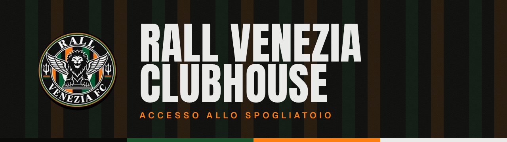

<p align="center">
  
</p>

<p align="center">
  <b>Accesso allo spogliatoio.</b><br>
  The private digital clubhouse of Rall Venezia FC: matches, squad, stats, the Gazzetta and the locker room, all in one place.
</p>

<p align="center">
  <code>Nuxt 4</code> · <code>Supabase</code> · <code>TypeScript</code> · <code>Vercel</code>
</p>

<p align="center"><i>Quello che succede nello spogliatoio resta nello spogliatoio.</i></p>

---

## What is this

The Instagram page is the public face of the club. This app is the world behind it: a football-club website, a private locker room, a statistics platform, a match archive and a pagelle archive, designed mobile first so it feels like a native sports app on a phone.

Everything is **private and invite-only**. There is no signup, no public profile, no public archive. Access is controlled by Supabase Auth and Row Level Security.

| | |
| --- | --- |
| **Home** | The squad on the club's stage, a live ticker, next match with countdown, availability, the weekly Mon-Fri poll, last result, form, scorers |
| **Partite** | Full match archive and a match "programme" page: score, goals timeline, lineup, MVP, ratings |
| **Squadra** | Editorial player cards with real photos (private storage) and profiles with derived stats |
| **Stats** | Team record and rankings: scorers, assists, MVPs, average rating |
| **Spogliatoio** | Availability for the next match and internal announcements |
| **Gazzetta** | Newspaper-style club news: front page, articles, and new Instagram posts imported automatically ([docs/INSTAGRAM.md](docs/INSTAGRAM.md)) |
| **Admin** | Quick post-match flow, players, matches, announcements, Gazzetta, Instagram, invites |

Roles: `admin`, `staff`, `player`, `viewer` (details in [docs/AUTHORIZATION.md](docs/AUTHORIZATION.md)).

## Identity

The club crest is the **winged lion roundel** on green and orange stripes. The whole product is built around its colours: a near-black base, orange as the only action colour, green for wins, cream for type, gold reserved for MVPs and records.

| | Token | Hex | Use |
| --- | --- | --- | --- |
|  | `--rv-black` | `#0B0B09` | page background |
|  | `--rv-orange` | `#FD7F10` | the one action colour, current location, next match |
|  | `--rv-green-deep` | `#19522B` | crest stripes, accents |
|  | `--rv-green` | `#3A9D5D` | wins, "available" (lighter so it reads on black) |
|  | `--rv-cream` | `#EAEBE9` | type, light panels |
|  | `--rv-gold` | `#D4AF37` | MVP, awards, Hall of Fame only |

**Type:** Anton for scores, names and headlines; Geist for the interface; Source Serif 4 for the Gazzetta articles. All self-hosted.
**Voice:** competitive, ironic, football-first. *"Tre punti portati a casa."* Italian UI, English code.
**Gazzetta:** the news section is a newspaper front page, cream paper with a big masthead, kickers and a lead story.

Full rules in [docs/DESIGN_SYSTEM.md](docs/DESIGN_SYSTEM.md). Crest artwork lives in `public/brand/`.

## Stack

- **Nuxt 4** (Vue 3, Composition API, TypeScript strict), plain CSS with design tokens
- **Supabase**: Postgres, Auth (invite-only), Row Level Security, private Storage
- **Vercel** for hosting. No other providers: self-hosted fonts, no analytics

## Quick start

Requirements: Node 22+, Docker.

```bash
npm install
cp .env.example .env            # then fill in the keys printed by `supabase start`
npx supabase start              # local Postgres + Auth + Storage
npm run db:reset                # apply migrations + seed data (+ re-upload private player photos if you have them)
npm run dev                     # http://localhost:3000
```

Local invite emails land in Mailpit at http://127.0.0.1:54324. Dev logins (seed only): `admin@`, `staff@`, `player@`, `viewer@example.invalid`, password `rall-dev-password`.

**Player photos** are private: they are never committed. Put each player's original at `private-assets/players/<slug>/source.jpg`, run `scripts/build-player-assets.sh` (portrait, hero and thumbnail derivatives) and `node --env-file=.env scripts/upload-player-assets.mjs`.

### Scripts

| Command | What it does |
| --- | --- |
| `npm run dev` | Dev server |
| `npm run build` | Production build |
| `npm run typecheck` | `vue-tsc` strict |
| `npm test` | Vitest unit tests |
| `npx supabase test db` | pgTAP: RLS and stats views |
| `npx playwright test` | E2E at 390x844 and 1440x900 (read-only specs in parallel, then the data-changing admin specs) |
| `npm run db:reset` | Reseed the local database and re-upload player photos |

## Project layout

```
app/          Nuxt app: assets/css (tokens), components, composables, layouts, middleware, pages
server/       Admin-only API routes (invites, roles) using the service-role key
supabase/     config, migrations, seed, pgTAP tests
docs/         product, architecture, database, authorization, routes, design system, deployment
tests/e2e/    Playwright specs
```

## Documentation

[Product](docs/PRODUCT.md) · [Architecture](docs/ARCHITECTURE.md) · [Database](docs/DATABASE.md) · [Authorization](docs/AUTHORIZATION.md) · [Routes](docs/ROUTES.md) · [Design system](docs/DESIGN_SYSTEM.md) · [Deployment](docs/DEPLOYMENT.md) · [MVP](docs/MVP.md) · [Implementation plan](docs/IMPLEMENTATION_PLAN.md) · [Instagram sync](docs/INSTAGRAM.md) · [Agent workflow](docs/AGENT-WORKFLOW.md)

## Security

Never commit secrets. The Supabase service-role key is server-only. Authorization is enforced by RLS, not by the UI. See [docs/AUTHORIZATION.md](docs/AUTHORIZATION.md).

---

<div align="center"><sub>Rall Venezia FC — competitive, ironic, football-first.</sub></div>
