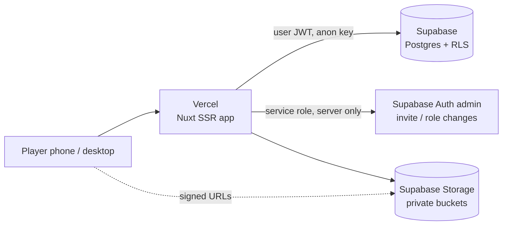

# Architecture

## Overview

Single protection layer, deliberately simple (hobby site, no Cloudflare or other proxy): **Supabase Auth** (who you are, invite-only, signups disabled) + `user_roles` + **Row Level Security** (what you may read/write). RLS is the real enforcement; Nuxt route middleware is UX only. Anyone can load the login page, but no data is readable without an invited account.

`robots.txt`, `noindex` and hidden URLs are not security. (We still send `X-Robots-Tag: noindex` as hygiene.)

## Stack decisions

| Concern | Choice | Why |
| --- | --- | --- |
| Framework | Nuxt 4 (Vue 3 Composition API, TypeScript strict) | Requested; `app/` + `server/` layout, SSR for fast first paint on phones |
| Supabase integration | `@nuxtjs/supabase` | Handles SSR cookie sessions and typed client; avoids hand-rolled auth plumbing. One dependency instead of ~150 lines of risky cookie code |
| Styling | Plain CSS with design tokens (`app/assets/css/`) | Same approach as Shiori: one tokens block, shared component classes, no UI kit. No Tailwind, no component library |
| State | Nuxt `useAsyncData` / `useState`; **no Pinia** unless a real need appears | Server data is fetched per page; the only global state is the session and profile |
| Fonts | Self-hosted (`@fontsource/*`): display = Anton (or Bebas Neue, decide at Stage 1 with a type specimen), UI = Geist | No third-party font provider (Shiori rule) |
| Charts | None in MVP; inline SVG sparkline/bars where useful | Avoid chart libraries |
| Unit tests | Vitest (stats helpers, formatters) | |
| DB tests | `supabase test db` (pgTAP) for RLS and views | Authorization is the highest-value test target |
| E2E | Playwright, at 390x844 and 1440x900 | Same bar as Shiori |
| Hosting | Vercel (app) + Supabase (db/auth/storage) | Simplest possible: two providers, no proxy, no custom infra |

Dependencies are added only when they replace real complexity.

## Server / client boundary

- **Browser** uses the *anon* key and the user's JWT only. Every query it makes is filtered by RLS. It can never perform a privileged action.
- **Nuxt server routes (`server/api/admin/*`)** are used *only* for operations RLS cannot express: inviting users (`auth.admin.inviteUserByEmail`), changing roles, deleting users. They:
  1. read the session from the cookie,
  2. load the caller's role **from the database**, never from the request body,
  3. refuse unless `admin`,
  4. then use the service-role client created from a server-only env var.
- The service-role key is in `runtimeConfig` (private), never in `public`, never in the client bundle. A CI grep guards against `SERVICE_ROLE` appearing under `app/`.
- All other reads/writes (matches, goals, availability, …) go straight from the client/SSR to Supabase under RLS. No custom REST layer to maintain.
- Multi-row workflows that must be atomic (e.g. "record match result": score + goals + assists + MVP) are Postgres RPC functions (`security invoker`, so RLS still applies), not chains of client calls.

## Authentication flow

1. `/login`: email + password via Supabase Auth. Signups are **disabled** in Supabase (`enable_signup = false`).
2. Invite: admin → `POST /api/admin/invite` → `inviteUserByEmail` → email link → `/auth/set-password` → session.
3. A trigger on `auth.users` insert creates a `profiles` row and a `user_roles` row with `viewer` (least privilege) — or the role requested in the invite metadata, applied by the server route, not by the trigger trusting metadata.
4. Global route middleware (`app/middleware/auth.global.ts`) redirects anonymous users to `/login` and checks route `meta.roles` for UX (403 page). RLS still enforces.

## Storage

Private buckets, per [DATABASE.md](DATABASE.md#storage): `player-avatars`, `player-photos`, `match-media`, `ratings`, `graphics`, `internal-documents`, `mascot`. Access via short-lived signed URLs minted server-side or via `createSignedUrls` under storage RLS. Opponent logos and avatars are small and may use image transformations for thumbnails (verify transformation availability on the Supabase plan before relying on it). Paths are stored in tables, never full URLs.

## Performance

SSR first paint, route-level code splitting (Nuxt default), `NuxtImg`-style responsive images with explicit width/height, lazy loading below the fold, skeletons for loading. Stats come from SQL views (one query per page), not client-side aggregation of many rows.

## Security assumptions

- The Supabase API URL and the Vercel site are public by design; protection is auth + RLS only. Hence RLS must be correct and is tested (pgTAP) before any real data goes in. Login rate limits come from Supabase Auth settings.
- Browsers are untrusted. Roles are never read from client-supplied data.
- Content Security Policy: strict as practical (no remote scripts, self-hosted fonts). Nuxt injects inline hydration data; use a nonce-based CSP (`nuxt-security` or a server middleware) in Stage 11 rather than `unsafe-inline`.
- Secrets live only in Vercel/Supabase env; `.env.example` has names only.

## Observability and backups

Application logs (Vercel), Supabase logs, deployment logs. No third-party monitoring in MVP (Sentry is a later option). Backups use Supabase-native backups (plan-dependent) plus a periodic `pg_dump` kept outside the repo — see [DEPLOYMENT.md](DEPLOYMENT.md#backups). Dumps contain personal data: never commit them.
