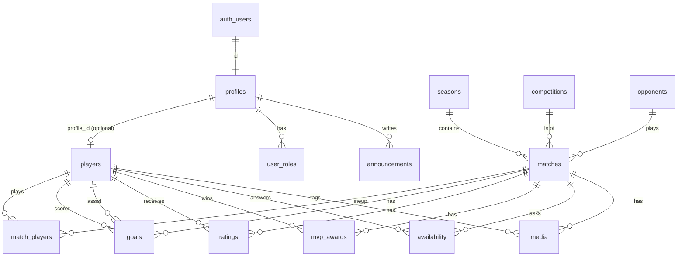

# Database

PostgreSQL on Supabase. UUID primary keys (`gen_random_uuid()`), `created_at`/`updated_at timestamptz default now()` on every table (with a shared `set_updated_at` trigger). Migrations live in `supabase/migrations/`, seed data in `supabase/seed/`.

## ER diagram

## Tables

Notation: `pk`, `fk`, `nn` = not null, `uq` = unique.

### `profiles`
One per auth user. `id uuid pk fk auth.users on delete cascade`, `email text nn`, `display_name text`, `created_at`, `updated_at`.

### `user_roles`
`user_id uuid pk fk profiles on delete cascade`, `role text nn check in ('admin','staff','player','viewer')`. One role per user (simplest; a person is exactly one role). A `text + check` instead of an enum so adding a role is a one-line migration. Changed only through the admin server route / RPC.

### `players`
`id pk`, `profile_id uuid uq fk profiles on delete set null` (optional link), `slug text nn uq`, `first_name nn`, `last_name nn`, `nickname text`, `shirt_number smallint check 0..99` (**nullable; do not invent**), `position text check in ('goalkeeper','defender','winger','midfielder','pivot')`, `is_captain bool default false`, `photo_path text`, `avatar_path text`, `is_active bool default true`, `bio text`.
Constraints: partial unique index on `shirt_number` where `is_active and shirt_number is not null`; at most one active captain (partial unique index on `is_captain` where `is_captain and is_active`).

### `seasons`
`id`, `name text nn uq` (e.g. `2025/26`), `starts_on date nn`, `ends_on date`, `is_current bool` (partial unique index → one current season).

### `competitions`
`id`, `name text nn uq`, `short_name text`.

### `opponents`
`id`, `name text nn`, `short_name text`, `logo_path text`. (Named `opponents` rather than `teams`: Rall Venezia is the single "us" club, so there is no `teams` ambiguity.)

### `matches`
`id`, `season_id fk nn`, `competition_id fk`, `opponent_id fk nn`, `is_home bool nn`, `kickoff_at timestamptz nn`, `venue text`, `status text nn default 'scheduled' check in ('scheduled','live','completed','postponed','cancelled')`, `rv_score smallint check >= 0`, `opp_score smallint check >= 0`, `notes text`, `graphic_path text`, `published bool default false`.
Check: `status <> 'completed' or (rv_score is not null and opp_score is not null)`. Indexes: `(season_id, kickoff_at desc)`, `(status, kickoff_at)`.
`rv_score`/`opp_score` are the *official result* and are stored, because amateur matches often have unrecorded goals and own goals; recorded `goals` rows are the detail. A view flags matches where recorded Rall goals exceed `rv_score`; the post-match RPC rejects that.

### `match_players`
Lineup/roster for a match. `match_id fk on delete cascade`, `player_id fk`, `is_starter bool default false`, `minutes smallint` (optional), `pk (match_id, player_id)`. A row means "played / was in the squad list"; appearances are derived from it.

### `goals`
`id`, `match_id fk on delete cascade nn`, `scorer_id fk players` (null = own goal credited to Rall), `assist_id fk players` (nullable), `minute smallint`, `is_own_goal bool default false`.
Checks: `assist_id is null or assist_id <> scorer_id`. Index: `(match_id)`, `(scorer_id)`, `(assist_id)`.
**Deviation from the brief:** assists are a nullable column on the goal, not a separate table — an assist belongs to exactly one goal, so a table adds a join and a consistency risk for nothing. A view `assists` (`select … from goals where assist_id is not null`) keeps the vocabulary.

### `mvp_awards`
`match_id fk on delete cascade`, `player_id fk`, `pk (match_id, player_id)` (allows a shared MVP; admin UI defaults to one). Trigger/RPC requires the player to be in `match_players` for that match.

### `ratings`
`id`, `match_id fk on delete cascade`, `player_id fk`, `author_id fk profiles on delete set null`, `score numeric(3,1) nn check between 0 and 10`, `review text`, `attributes text[] default '{}' check (cardinality <= 4)`, `published bool default false`, `uq (match_id, player_id)`. Index `(player_id)`.

### `availability`
`match_id fk on delete cascade`, `player_id fk`, `status text nn check in ('available','unavailable','maybe')`, `responded_at timestamptz nn default now()`, `pk (match_id, player_id)`. "No response" = no row (derived). Upsert by the player for their own row, only while `kickoff_at > now()`.

### `announcements`
`id`, `author_id fk profiles`, `title nn`, `body nn`, `pinned bool default false`, `published_at timestamptz` (null = draft).

### `media`
`id`, `bucket text nn`, `path text nn`, `kind text nn check in ('photo','graphic','pagella','meme','video','announcement')`, `title text`, `match_id fk`, `player_id fk`, `season_id fk`, `min_role text nn default 'player' check in ('viewer','player')` (viewer-visible or not), `uploaded_by fk profiles`, `uq (bucket, path)`. Phase 2 UI; table created in the first schema so nothing blocks later.

### `mascot`
Single-row table (`id`, `name`, `photo_path`, `bio`). Phase 2.

## Views (all `security_invoker = true` so RLS of the caller applies)

| View | Purpose |
| --- | --- |
| `player_season_stats` | per `(player_id, season_id)`: appearances, goals, assists, mvps, wins, avg_rating, goals_per_game, attendance (appearances / completed matches) |
| `player_career_stats` | same across seasons |
| `player_rating_summary` | avg score, count, best score, last score |
| `team_season_stats` | played, W/D/L, GF, GA, GD, points-less (no league table), form (last 5) |
| `assists` | alias over `goals` |
| `match_result_issues` | matches whose recorded goals exceed the official score |

No counters are stored on `players`. If a view is ever too slow it becomes a materialized view refreshed by the post-match RPC; not before measurements say so.

## RPC functions (security invoker)

- `record_match_result(match_id, rv_score, opp_score, goals jsonb, mvp_ids uuid[], lineup jsonb)` — atomic post-match write; validates consistency.
- `set_availability(match_id, status)` — upsert for `auth` player's own row.
- `current_role()` / `has_role(variadic roles)` — `security definer`, `stable`, `set search_path = ''`, read `user_roles` for `auth.uid()`. Used by every policy.

## Indexes

On every foreign key; plus the ones named above and `ratings(player_id)`, `goals(scorer_id)`, `availability(match_id)`, `announcements(published_at desc)`, `media(match_id)`, `media(player_id)`.

## Storage

| Bucket | Content | Read |
| --- | --- | --- |
| `player-avatars` | small square avatars | all signed-in roles |
| `player-photos` | hero portraits | all signed-in roles |
| `match-media` | match photos/videos | per `media.min_role` |
| `ratings` | pagella Instagram art | player, staff, admin |
| `graphics` | match graphics, logos | all signed-in roles |
| `internal-documents` | internal docs | player, staff, admin |
| `mascot` | mascot art | all signed-in roles |

All private. Write: staff/admin (admin only for `internal-documents`). Storage RLS policies mirror the table rules via `has_role`.

## Seed data

`supabase/seed/seed.sql`: one season, one competition, a few opponents, the seven named players (Daniele Nappo #1 captain GK, Antonio Verrone #8, Alfonso Avino #33, Salvatore Marigliano #9, Raffaele Miranda, Sergio Batti, Francesco Ferrara — numbers `null` where not stated, positions only where known, else `null`), and sample matches/goals/ratings clearly marked as fake. No personal details.
